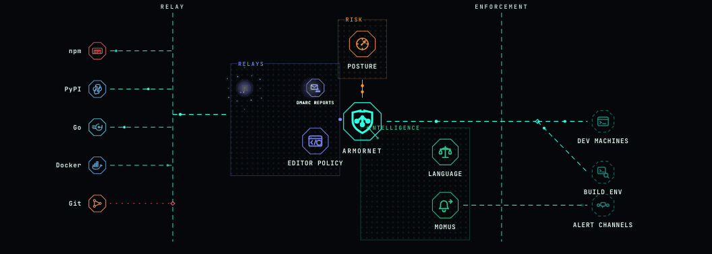
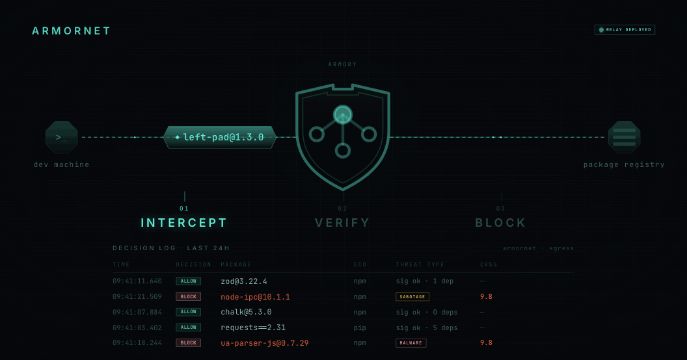
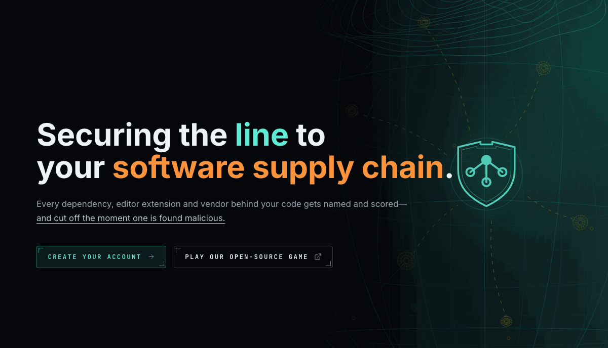
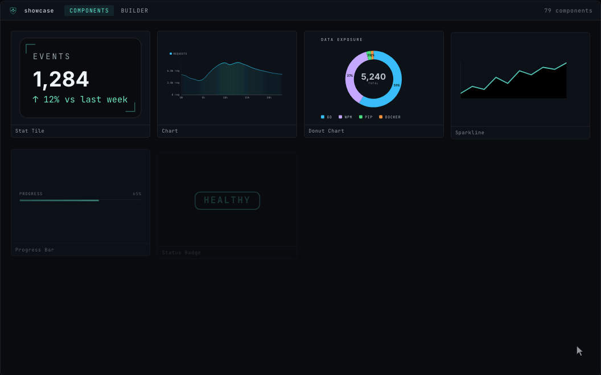

<p align="center">
  
</p>

<p align="center">
  <a href="https://armornet.io"><b>armornet.io</b></a> &nbsp;·&nbsp;
  <a href="https://armornet.io/breach">play breach</a> &nbsp;·&nbsp;
  <a href="https://github.com/ArmornetIO/showcase">showcase</a> &nbsp;·&nbsp;
  <a href="mailto:alpha@armornet.io">alpha@armornet.io</a>
</p>

**Nobody knows what their build machines fetched yesterday. Armornet does.**

Armornet puts an agent you run in the path between your code and everything it
pulls: npm, pip, Go, Cargo, Maven, RubyGems, Docker images, git and editor
extensions. Every fetch is named, scored and
recorded, from laptop to CI. A package that turns malicious gets a 403 before a
single byte lands. Clean code flows untouched.

```console
$ npm install event-stream@3.3.6
npm error code E403
npm error 403 Forbidden - GET …/flatmap-stream/-/flatmap-stream-0.1.1.tgz

# meanwhile, on the agent
level=WARN msg="relay.npm: blocked" pkg=flatmap-stream version=0.1.1 reason="known malicious"
```

---

### `/ IN THE PATH`



Every fetch leaves through an agent you run. Stopped in the path where we can,
on the device where we must.

### `/ SEE WHAT YOUR BUILD PULLED`



Every allow and every block, with the reason it was decided, across pip, npm
and Go. Today's blocks re-score tomorrow's fetch.

### `/ HOW IT FITS`



| | |
|---|---|
| **Armornet** | The server. Holds the verdicts, the vendor register and the record of every fetch. |
| **The Armory** | Every Agent under one Armornet. |
| **Agent** | One unit, one job: supply-chain proxy, DNS filter, threat monitor. Runs on laptops, CI runners and office networks. |
| **Line** | The interconnect. Agents talk to Armornet, and to each other, over Line and nothing else. |

---

### `/ IN THE OPEN`

<table>
<tr>
<td width="50%" valign="top">
<br>
<b>Armornet Breach</b>. Attack. Defend. Understand.<br>
Play Red. Play Blue. Or go Purple and do both. 12 rounds, solo or 2v2, in your browser.<br>
<a href="https://armornet.io/breach"><code>ENTER GAME →</code></a>
</td>
<td width="50%" valign="top">
<br>
<b>Showcase</b>. Browse. Compose. Ship.<br>
300+ Svelte 5 components that describe themselves to an agent. Registry-driven, Apache-2.0.<br>
<a href="https://github.com/ArmornetIO/showcase"><code>OPEN SHOWCASE →</code></a>
</td>
</tr>
</table>

---

<p align="center"><sub>
  Armornet is in alpha. Request access at <a href="https://armornet.io">armornet.io</a>.
</sub></p>
